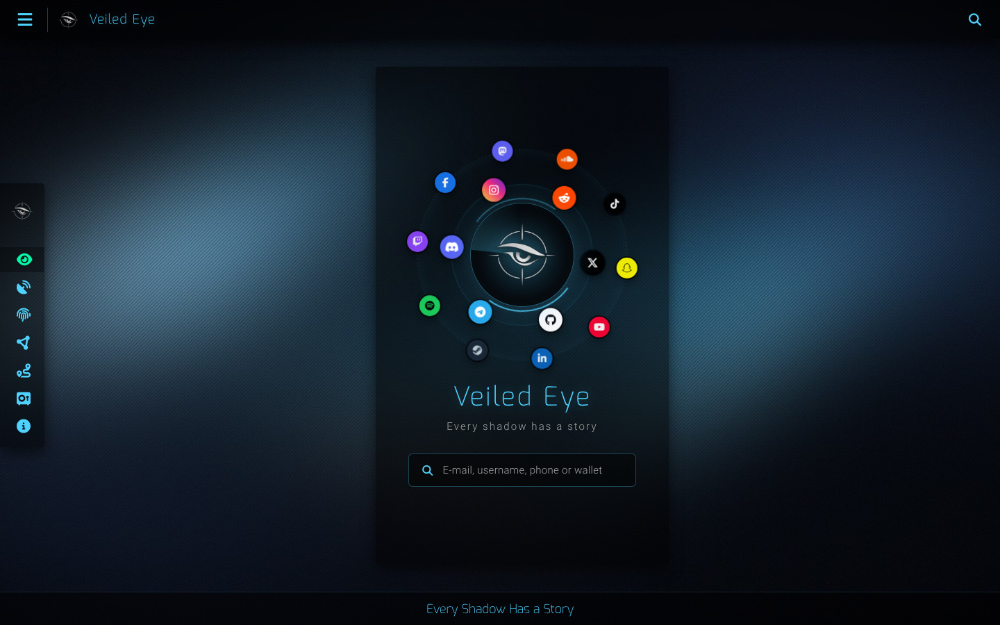
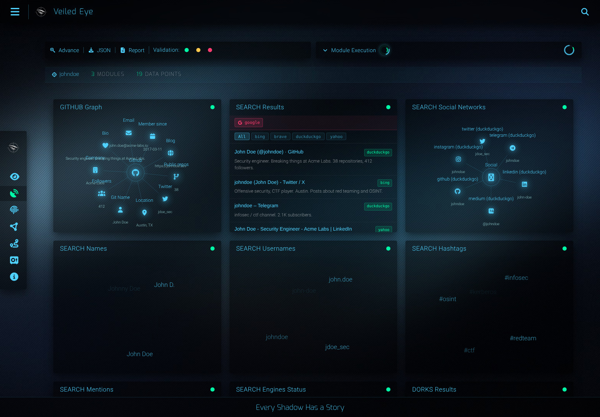
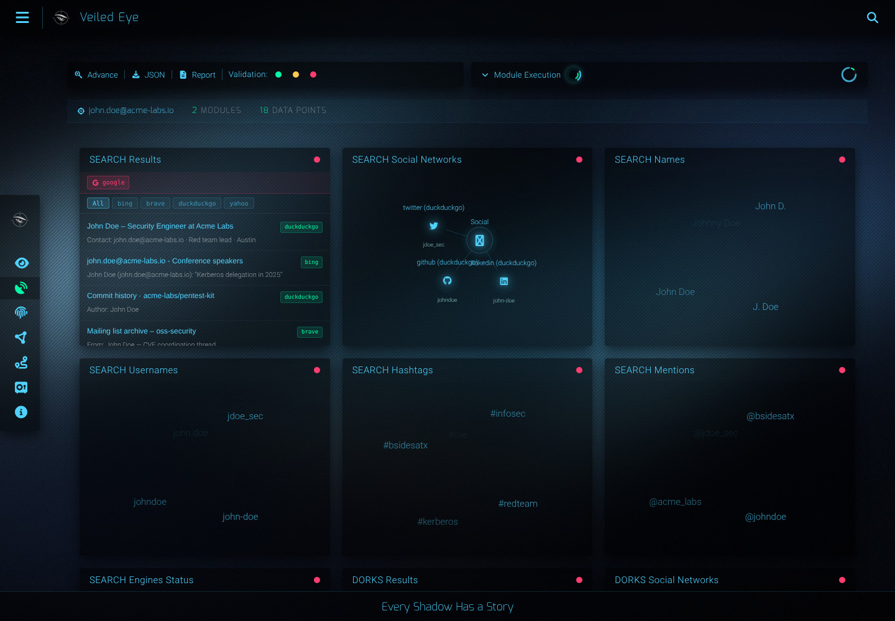
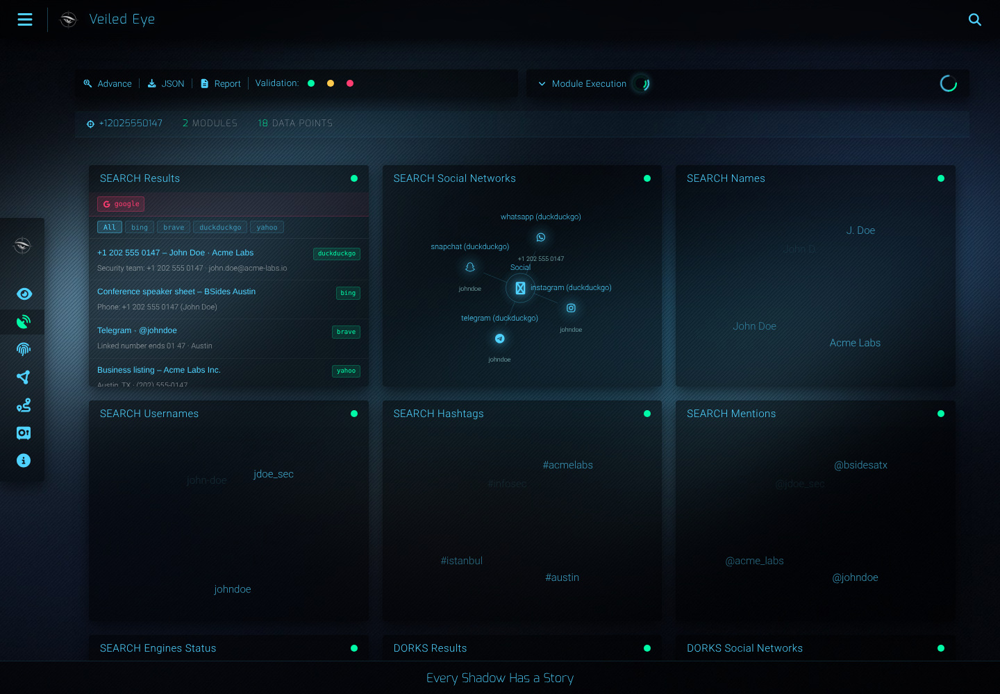
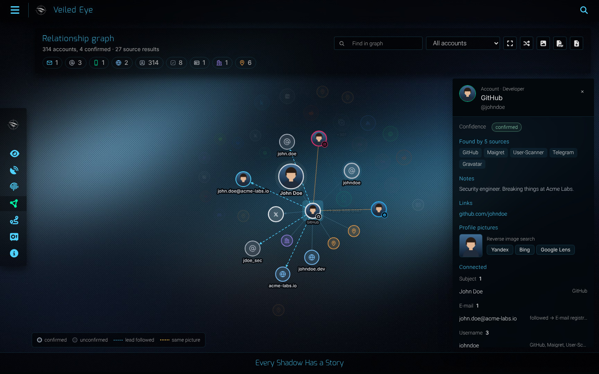

<p align="center"></p>
<h1 align="center">Veiled Eye</h1>
<p align="center"><em>Every shadow has a story.</em></p>

Identity investigation for OSINT and CTI. Give it an e-mail, username, phone
number or crypto wallet. It runs 46 sources in parallel, follows every lead
they return and correlates everything into one profile.

<p align="center"></p>

## Install

```shell
pipx install veiled-eye      # recommended
# or
pip install veiled-eye
```

### From source (without PyPI)

```shell
git clone https://github.com/emrekybs/veiled-eye
cd veiled-eye
python3 -m venv .venv && source .venv/bin/activate
pip install -e .
```

or in one line, isolated: `pipx install git+https://github.com/emrekybs/veiled-eye`

## Run

```shell
veiled-eye serve             # web UI → http://127.0.0.1:4300
```

`serve` needs Redis. If `redis-server` is installed it is started for you,
otherwise run `docker run -d -p 6379:6379 redis:7-alpine`.

Prefer the terminal? No Redis needed:

```shell
veiled-eye scan johndoe
veiled-eye scan -e john.doe@acme-labs.io -x html,pdf --outdir case/
```

Other commands: `veiled-eye modules`, `veiled-eye doctor`, `veiled-eye proxies`.
Keys, cookies and the proxy list are set in the web UI under **API Keys**.

## What you get

**Username**

<p align="center"></p>

**E-mail**

<p align="center"></p>

**Phone**

<p align="center"></p>

**Relationship graph**

<p align="center"></p>

Exports: PDF / HTML report, STIX 2.1, GraphML, CSV, JSON.

## Docker

```shell
git clone https://github.com/emrekybs/veiled-eye && cd veiled-eye
docker compose up -d         # http://localhost:4300
```

## Responsible use

Investigate only people and organisations you are authorised to. Veiled Eye
reads public data; sessions you add are only used to read public profiles.

## License

GPL-3.0-or-later. See [LICENSE](LICENSE), [NOTICE](NOTICE) and
[CREDITS](CREDITS.md). By Emre Köybaşı.
